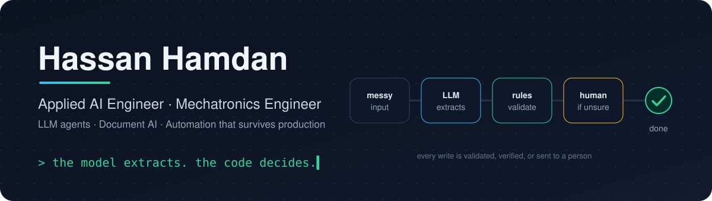

  

  
  
  

---

### 👋 Hi, I'm Hassan

I'm a **mechatronics engineer** who ended up teaching machines to do paperwork.

My favourite problems start in a spreadsheet, an inbox or a phone call: a process that people repeat every day,
full of exceptions nobody wrote down. I sit with the people who do the work, map the real rules, and then build
the **LLM agents, document pipelines and integrations** that take it off their plate.

Code and AI are my tools, not my identity. The goal is always the same: **it has to work on Monday morning**,
with real data and real customers.

### 🧭 How I work

- **The model extracts, the code decides.** LLMs read messy documents and conversations. Deterministic rules validate,
  and anything uncertain goes to a person. Nothing gets written on a model's word alone.
- **Fail closed.** When in doubt, don't write. A skipped record can be retried. A wrong write to a customer's system can't.
- **The simplest thing that works.** I've cut five workflows plus a database down to one workflow, and the system got better.
- **Verify, don't trust.** APIs return `success: true` for things they didn't save, so I read back after every write.
- **Tests and evals, even for prompts.** If a model swap could break it, there's a test that would notice.

### 🛠️ Featured projects

<table>
  <tr>
    <td width="50%" valign="top">
      <h4><a href="https://github.com/hassan-hamdan99/n8n-ai-agents">🤖 n8n-ai-agents</a></h4>
      WhatsApp and <b>pt-PT voice</b> receptionists that book real appointments: a debounced inbox, voice in and out,
      calendar tools over <b>MCP</b>, and authenticated, idempotent booking.  
      
      
      
      
    </td>
    <td width="50%" valign="top">
      <h4><a href="https://github.com/hassan-hamdan99/finance-dashboard">💸 finance-dashboard</a></h4>
      Bank-statement analytics with <b>hybrid categorization</b>: rules first, then rules learned from your corrections,
      then a semantic-embedding fallback. Idempotent imports and anomaly and recurring-charge insights.  
      
      
      
    </td>
  </tr>
  <tr>
    <td width="50%" valign="top">
      <h4><a href="https://github.com/hassan-hamdan99/ticket-classifier">🎫 ticket-classifier</a></h4>
      Explainable ticket routing (department + category) that <b>masks personal data before the model sees it</b>.
      A cheap, auditable baseline to try before reaching for an LLM.  
      
      
      
    </td>
    <td width="50%" valign="top">
      <h4><a href="https://github.com/hassan-hamdan99/guarded-agent">🛡️ guarded-agent</a></h4>
      An LLM agent that <b>writes</b> to a real system and still can't hurt it: approval gates enforced in code,
      read-after-write checks that catch APIs lying about saves, PII allowlists, and evals.  
      
      
      
    </td>
  </tr>
</table>

### 🧰 Toolbox

  

  
  
  
  
  
  
  
  

### 🗣️ Languages

  
  
  
  

### ☕ Off the clock

<table>
  <tr>
    <td align="center" width="50%">📚 <b>Comics & manga</b> so much that I built my own reader</td>
    <td align="center" width="50%">🎮 <b>Games</b> still the best way to learn a system: break it</td>
  </tr>
</table>
